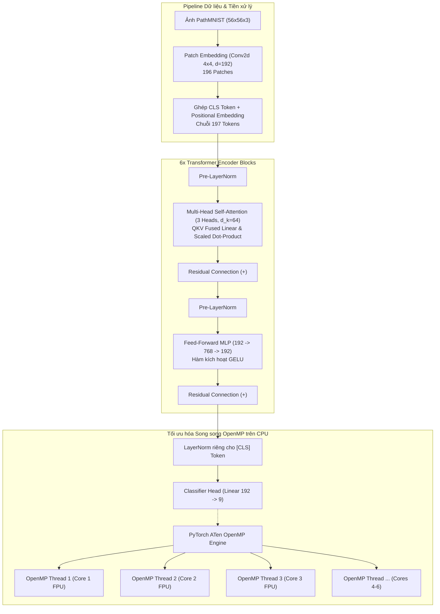

# Vision Transformer (ViT) on CPU: OpenMP Parallel Optimization & Scalability Benchmark

[](https://www.python.org/)
[](https://pytorch.org/)
[](https://www.openmp.org/)
[-ED1C24.svg?style=flat&logo=amd&logoColor=white)](https://www.amd.com/)
[](https://medmnist.com/)
[](LICENSE)

Dự án nghiên cứu, lập trình và tối ưu hóa hiệu năng tính toán của mô hình **Vision Transformer (ViT)** trên kiến trúc phần cứng **CPU** thông qua cơ chế song song hóa đa luồng **OpenMP**. Hệ thống tập trung đánh giá tính co giãn hiệu năng (Scalability), tốc độ suy luận (Throughput/Latency), mức tiêu thụ bộ nhớ (RAM RSS/Peak) và kiểm chứng Định luật Amdahl (Amdahl's Law) trên bài toán phân loại ảnh mô bệnh học `PathMNIST`.

---

## 1. Kiến trúc Hệ thống & Luồng Xử lý

Mô hình được xây dựng theo chuẩn kiến trúc Vision Transformer (Dosovitskiy et al.) cho đầu vào ảnh mô học $56 \times 56$ RGB (9 phân lớp):



---

## 2. Thông số Mô hình & Độ phức tạp Tính toán

* **Kích thước ảnh đầu vào ($H \times W$):** $56 \times 56$, 3 kênh màu (RGB).
* **Kích thước Patch ($P \times P$):** $4 \times 4$ $\rightarrow$ Số lượng token ảnh $N = (56/4)^2 = 196$ tokens (+1 `[CLS]` token = $197$ tokens).
* **Chiều ẩn (Embedding Dimension $D$):** $192$.
* **Độ sâu Transformer (Depth $L$):** $6$ Blocks Encoder.
* **Số lượng Attention Heads ($h$):** $3$ Heads (Head dimension $d_k = 192 / 3 = 64$).
* **MLP Expansion Ratio:** $4$ (Hidden Dimension $D_{mlp} = 192 \times 4 = 768$).
* **Tổng số tham số (Parameters):** **2,713,929 tham số** (~$2.7\text{M}$).
* **Độ phức tạp tính toán lý thuyết (FLOPs):** **1.2282 GFLOPs / ảnh** (~$0.6141\text{ GMACs}$).

---

## 3. Kết quả Thực nghiệm & Phân tích Hiệu năng (HPC Analysis)

Thực nghiệm được đo đạc trực tiếp trên nền tảng CPU **AMD 6 Nhân vật lý / 12 Luồng logic**, $14.65\text{ GB RAM}$, PyTorch CPU với OpenMP 2019 backend.

### 3.1. Đánh giá Tốc độ Suy luận theo Kích thước Batch (`results/cpu_benchmark.csv`)
*Quy chuẩn đo:* $10$ iterations Warmup, $30$ iterations Benchmark, đo đạc phân vị Median, P25, P75 và lượng RAM tiêu thụ qua hệ điều hành.

| Batch Size | Precision | First Call (ms) | Median Latency (ms) | P25 (ms) | P75 (ms) | Throughput (img/s) | RAM Tiêu thụ (RSS) | Achieved GFLOPS |
| :---: | :---: | :---: | :---: | :---: | :---: | :---: | :---: | :---: |
| **1** | FP32 | 40.28 ms | 15.97 ms | 14.57 ms | 18.18 ms | **62.63** | 252.71 MB | 76.93 |
| **8** | FP32 | 98.14 ms | 95.22 ms | 88.62 ms | 102.50 ms | **84.01** | 275.77 MB | 103.19 |
| **32** | FP32 | 435.22 ms | 426.53 ms | 412.80 ms | 440.81 ms | **75.02** | 264.64 MB | 92.15 |
| **64** | FP32 | 828.29 ms | 776.44 ms | 747.12 ms | 806.49 ms | **82.43** | 321.46 MB | 101.24 |

> **Nhận xét hiệu năng:**
> * Tốc độ suy luận đạt thông lượng tối ưu ở Batch Size 8 (**$84.01\text{ img/s}$**) và duy trì mức ổn định cao ở Batch Size 64 (**$82.43\text{ img/s}$**).
> * Mức tiêu thụ bộ nhớ RAM cực kỳ tối ưu (chỉ dao động từ $252\text{MB}$ đến $321\text{MB}$), chứng minh tính khả thi của ViT trên thiết bị biên / CPU server phổ thông.

---

### 3.2. Thực nghiệm Đa luồng OpenMP Thread Scaling (`results/openmp_thread_scaling.csv`)
Đo đạc trên Batch Size 32 cố định để khảo sát hệ số gia tốc (Speedup $S_N = \frac{T_1}{T_N}$) và hiệu suất song song (Parallel Efficiency $E_N = \frac{S_N}{N}$):

| Số luồng OpenMP | Latency (ms) | Throughput (img/s) | Speedup ($S_N$) | Parallel Efficiency ($E_N$) | Trạng thái Thực thi |
| :---: | :---: | :---: | :---: | :---: | :--- |
| **1 luồng** | 1301.29 ms | 24.59 img/s | **1.00x** | 100.0% | Đơn nhân (Baseline) |
| **2 luồng** | 712.41 ms | 44.92 img/s | **1.83x** | 91.5% | Mở rộng tuyến tính cao |
| **4 luồng** | 611.79 ms | 52.31 img/s | **2.13x** | 53.2% | Bắt đầu nghẽn bus bộ nhớ |
| **6 luồng** | **416.32 ms** | **76.86 img/s** | **3.13x** | **52.2%** | **Tối ưu nhất (Full 6 Cores vật lý)** |
| **12 luồng** | 435.82 ms | 73.42 img/s | **2.99x** | 24.9% | Bão hòa SMT / Contention |

---

### 3.3. Phân tích Chuyên sâu về Hiện tượng Bão hòa Luồng (SMT Contention)
1. **Gia tốc nhân thực (1 -> 6 Cores):** Khi nâng từ 1 luồng lên 6 luồng (tương ứng 6 nhân vật lý), thời gian thực thi giảm mạnh từ $1.30\text{s}$ xuống còn **$0.41\text{s}$** (tăng tốc **$3.13\times$**).
2. **Hiện tượng giảm nhẹ ở 12 luồng SMT:** Khi kích hoạt 12 luồng logic (Simultaneous Multi-Threading), hiệu năng không tăng mà có xu hướng chững lại ($435.82\text{ms}$ so với $416.32\text{ms}$).
   * **Nguyên nhân kiến trúc:** Trong các tác vụ tính toán ma trận dày đặc (SGEMM trong Attention và MLP), các nhân CPU hoạt động ở chế độ Vector FPU (AVX2/FMA) liên tục. Vì 2 luồng logic trên cùng 1 core vật lý phải chia sẻ chung đơn vị thực thi FPU và bộ đệm L1/L2 cache, việc phân chia 12 luồng làm phát sinh hiện tượng *cache thrashing* và chi phí đồng bộ hóa barrier (`#pragma omp barrier`).
   * **Khuyến nghị HPC:** Điểm hoạt động tối ưu nhất cho mô hình ViT trên CPU là **thiết lập số luồng bằng đúng số nhân vật lý** (`num_threads = 6`).

---

## 4. Cấu trúc Dự án

```
vit-cpu-openmp/
├── requirements.txt                 # Khai báo các thư viện phụ thuộc
├── README.md                        # Báo cáo kỹ thuật và tài liệu hướng dẫn
├── CPU.ipynb                        # Interactive Jupyter Notebook đầy đủ biểu đồ
├── vit_cpu/
│   ├── __init__.py
│   ├── models/
│   │   ├── __init__.py
│   │   └── vit.py                   # Kiến trúc VisionTransformer, Attention, MLP
│   ├── utils/
│   │   ├── __init__.py
│   │   ├── openmp_config.py         # Quản trị luồng OpenMP, Core affinity, CPU specs
│   │   └── profiling.py             # Tính toán FLOPs lý thuyết, RAM RSS, Latency stats
│   ├── train.py                     # Pipeline huấn luyện và đánh giá trên PathMNIST
│   └── benchmark.py                 # Pipeline benchmark kích thước dữ liệu & OpenMP scaling
└── results/                         # Toàn bộ dữ liệu thực nghiệm đã xuất bản
    ├── config.json                  # Cấu hình siêu tham số
    ├── cpu_benchmark.csv            # Độ trễ & Throughput theo Batch Size [1, 8, 32, 64]
    ├── openmp_thread_scaling.csv    # Kết quả đo đa luồng OpenMP (Speedup & Efficiency)
    └── cpu_memory_flops.csv         # Thống kê RAM & FLOPs đạt được
```

---

## 5. Hướng dẫn Khởi chạy (Quickstart)

### 5.1. Cài đặt Môi trường
Yêu cầu Python 3.10+ (Đã kiểm thử tối ưu trên Python 3.13):
```powershell
pip install -r requirements.txt
```

### 5.2. Chạy Thực nghiệm Benchmark & OpenMP Scaling
Chạy toàn bộ bài đo và tự động xuất các bảng số liệu vào thư mục `results/`:
```powershell
python vit_cpu/benchmark.py --batch-sizes 1 8 32 64 --scaling-batch-size 32
```

### 5.3. Huấn luyện Mô hình trên CPU (Tùy chọn)
Chạy huấn luyện trên tập dữ liệu PathMNIST:
```powershell
python vit_cpu/train.py --epochs 1 --batch-size 64
```
*(Hỗ trợ nạp sẵn checkpoint trọng số bằng cờ `--load-checkpoint <path_to_checkpoint.pt>`)*.

### 5.4. Trực quan hóa với Jupyter Notebook
Mở notebook tương tác để theo dõi biểu đồ đường cong Speedup và ma trận phân loại:
```powershell
jupyter notebook CPU.ipynb
```

---

## 6. Giấy phép (License)
Dự án được phân phối dưới giấy phép **MIT License**.
